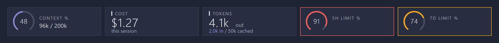
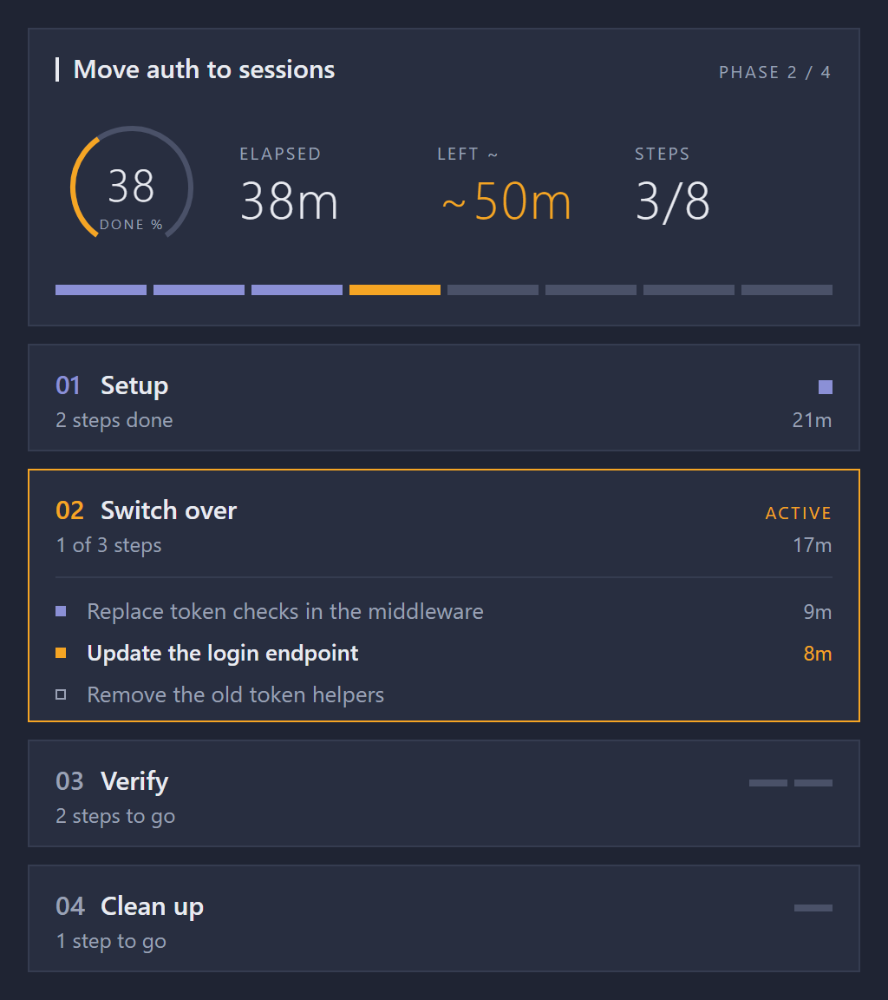
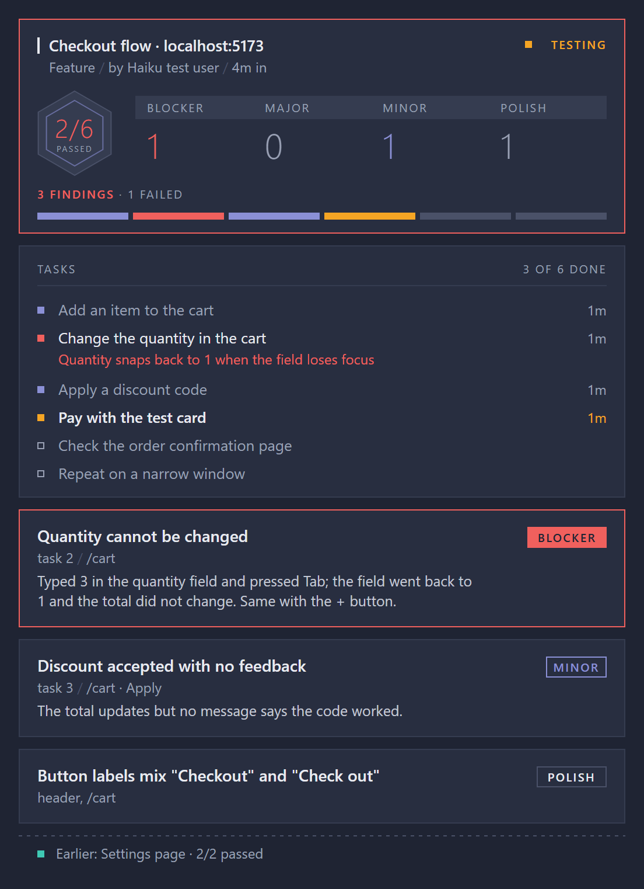
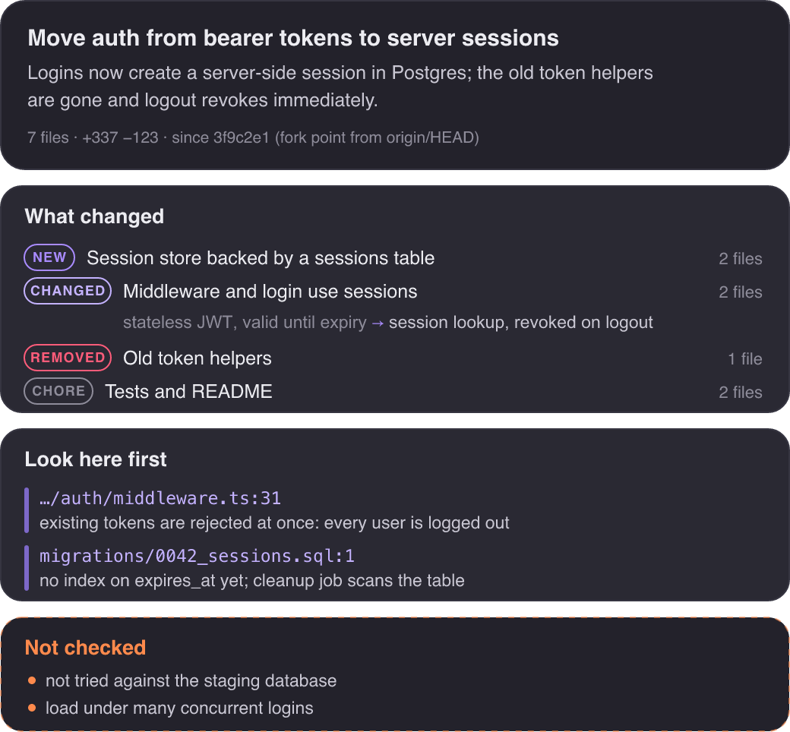

# claude-code-mods

My [Claude Code mods](https://code.claude.com/docs/en/plugins/mods/overview.md), one folder per mod. Needs Claude Code 2.1.287 or newer.

| Mod | What it does |
| --- | --- |
| [usage-band](usage-band) | A band above the prompt showing context fill, tokens, cost and rate limits: stat tiles in the desktop app, a coloured row in the terminal |
| [plan-progress](plan-progress) | Reads a phased plan into a live progress tree: phases, steps, elapsed time and an estimate of what is left |
| [test-user](test-user) | A Haiku test user that clicks through your locally running app and reports UI/UX issues: its task list, findings and failures in a live pane |
| [change-card](change-card) | A short card explaining what an agent changed on this branch: a headline, a few one-line changes, where to look first and what was not checked |
| [control-tower](control-tower) | A board for a sentinel-hill hub: every ticket worktree with its PR, checks and next step, the validate run above the prompt, and guard rails that enforce the hub's steering |

The first four mods share one look: dark violet cards with a lilac accent. In the desktop app's Code tab they draw as images (cards, tiles, gradients); in the terminal they use the same colours as text. control-tower has its own, dark only: near-black cards, dot-matrix headings and one orange accent.



## Install

At the prompt of a terminal Claude Code session:

```
/plugin install usage-band --marketplace WeaponizedLego/claude-code-mods
/plugin install plan-progress --marketplace WeaponizedLego/claude-code-mods
```

Answer `y` to add the marketplace, then pick the user scope. Or from a shell:

```bash
claude plugin marketplace add WeaponizedLego/claude-code-mods
claude plugin install usage-band@claude-code-mods
claude plugin install plan-progress@claude-code-mods
```

Update later with `claude plugin marketplace update claude-code-mods`, then `claude plugin update usage-band@claude-code-mods`.

## plan-progress



When a plan with several phases is approved in plan mode, the mod reads its phases and steps (`## Phase 1: ...` headings, other work headings, or a nested list) into a tree and opens it in a pane. In the terminal it looks like this:

```
Move auth to sessions                         20m in · ~40m left
▰▰▰▰▰▰▱▱▱▱▱▱▱▱▱▱▱▱ 33%  2/6 steps · phase 2/3

✓ 1 Setup                                                 20m
  ├ ✓ Add the sessions table                              10m
  └ ✓ Write the session store                             10m
● 2 Switch over
  ├ ● Replace token checks in the middleware
  ├ ○ Update the login endpoint
  └ ○ Remove the old token helpers
○ 3 Verify
  └ ○ Run the auth test suite
```

The status line carries the short form (`▰▰▱▱ 2/6 · phase 2/3: Switch over · 20m in · ~40m left`). Steps move when Claude calls the mod's `plan_mark` tool, or by themselves when Claude's tasks or todos are named like a step. Without plan mode, ask Claude to lay the work out in phases and it calls `plan_set`. The estimate is the pace so far times the steps left.

During a run of small steps Claude can forget to mark them. When the tree hasn't moved for a while (at least 6 tool calls, and 3 minutes or 1.5× the pace so far, whichever is longer), the next tool result reminds Claude which step the tree shows. Claude can then catch up in one call: `plan_mark` with `through: true` closes every earlier open step and splits the elapsed time evenly between them.

`/plan-progress` opens the tree (it also works mid-turn); `/plan-progress clear` stops tracking.

## test-user



A test user for the app you are running locally. Ask Claude to "test the app" (or a feature, a page, a flow) and it hands the job to `test-user:tester`, a subagent on Haiku that drives the app in the browser the way a person would: it works out what to test, finds the app (the URL you gave, `.claude/launch.json`, `package.json`), plans a handful of user tasks, works through them and reports each problem it sees. It never edits code, stays on localhost and only uses test data.

When you just say "test the app", Claude points it at the feature most recently built in the session; with nothing built, the tester looks at `git diff` and `git log` for a recent feature, and failing that tests the whole application.

The pane shows the run as it goes: status, tasks passed out of total, a count per severity (blocker, major, minor, polish), the task list with a note on each failure, a card per finding (worst first, with where and how to reproduce), a red card when it could not test at all, and earlier runs folded at the bottom. The status line carries the short form (`test-user ● 3/6 tasks · 2 findings · 4m · Pay with the test card`) and a toast says how it ended.

The session gets the full record, not just the tester's closing message: it rides back on the Agent result when the tester ran in the foreground, and on the next prompt (or the background task's notification) otherwise; `test_report` reads it any time. A tester whose turn ends early and is resumed carries on with the same run.

Claude gets the same reporting tools (`test_plan`, `test_task`, `test_finding`, `test_finish`), so a test it runs by hand shows in the pane too, and it can amend the latest tester run with what it re-checked. If the tester stops without a verdict, the record decides it; a "passed" never hides a failed task.

`/test-user` opens the pane; `/test-user run [what to test]` starts a run; `/test-user clear` forgets the runs.

## change-card



`/changes` opens a Changes pane and asks Claude to explain what changed on the branch since it forked from `origin/HEAD` (or `main`/`master`), uncommitted and untracked files included. Run from a folder that is not itself a repository but holds checkouts (a task folder with one worktree per repo), it reads each of them and prefixes their paths with the folder's name. Claude answers by filling in the mod's `change_card` tool, which keeps the card short by refusing anything over its limits: a 70-character headline, a one-sentence gist, at most 5 one-line changes (with an optional `before → after`), at most 3 places to look first and 3 things nobody checked. Every changed file has to sit under one of the changes (a path ending in `/` covers a folder), so nothing hides.

When the code moves on after the card was written, the pane says which files and `/changes` asks Claude to update just what they affect. After a turn that leaves a sizeable diff (over 5 files or 200 lines) a toast suggests `/changes`, once per card; nothing is written unasked.

`/changes <worktree or branch>` explains that one instead of the session's own checkout: a worktree by its path, folder name, branch or any unique part of those (`/changes PLAT-421`), or a local branch at its tip. When the session's checkout has nothing changed (say, `main` with the work in `.claude/worktrees/`), `/changes` lists the worktrees that do. `/changes <ref>` compares against another ref; `/changes clear` forgets the card.

## control-tower

For a sentinel-hill hub: a repo you run agents from, with a `repos.yaml` registry, `scripts/worktree.sh` and one worktree per ticket under `work/<repo>/<KEY>-<slug>`. The mod does nothing in any other folder.

The pane opens when a session starts in the hub (or with `/tower`). It reads every worktree under `work/` from disk and asks `gh` about its PR: one card per ticket, those that need you first, each with a big dot-matrix number (unresolved review threads, checks passed, commits ahead, time since merge) beside a five-stop track (start, build, PR, feedback, close). Under each card are buttons for the next step: Review and Finish while you build, Handle feedback when a PR has unresolved threads, Fix checks when they fail, Close task once it is merged. They run the hub's own skills (`/review`, `/task-finish`, `/handle-pr-feedback`, `/task-close`). A field at the bottom starts a ticket with `/task-start` or `/implement-ticket`. The board syncs every 3 minutes and after a push or `gh pr create`; a toast says when a PR gets new review threads or is merged.

Above the prompt, a band shows the repo's `validate` commands from `repos.yaml` as Claude runs them (done out of total, one bar per command, what is running or failed), or says when the hub is not set up (`repos.local.yaml` missing, or a `gh` token without `read:packages`) with a button that walks you through it. The status line names the ticket Claude is working in: `● OPS-123 · platform-apps · base develop · unattended`.

Guard rails refuse tool calls that break the hub's steering, with the reason as the tool result so Claude fixes the call and carries on:

- `git add -A`, `.`, `-u` and the like: add files by name
- a commit message that does not match the repo's `commit_format` with the branch's key, or that carries a Co-Authored-By or "Generated with" line
- `git merge`
- `gh pr create` from a ticket worktree without `--draft`, or without the label and assignee the repo's `pr_labels` and `pr_assignee` ask for
- writing into a clone listed in `repos.local.yaml` (the worktree is the place), or into `/tmp` (use `work/scratch/`)
- a Jira key in code or comments inside a worktree (prose files are fine)

The Unattended and Interactive buttons set the hub's mode: in interactive mode each prompt reminds Claude to stop for approval after the plan. `/tower refresh` syncs now; `/tower interactive` and `/tower unattended` set the mode.

## Adding a mod

Put it in its own folder (`<mod>/.claude-plugin/plugin.json`, `<mod>/hooks/...`) and add an entry to `.claude-plugin/marketplace.json`. Check it with `claude plugin validate .`.
